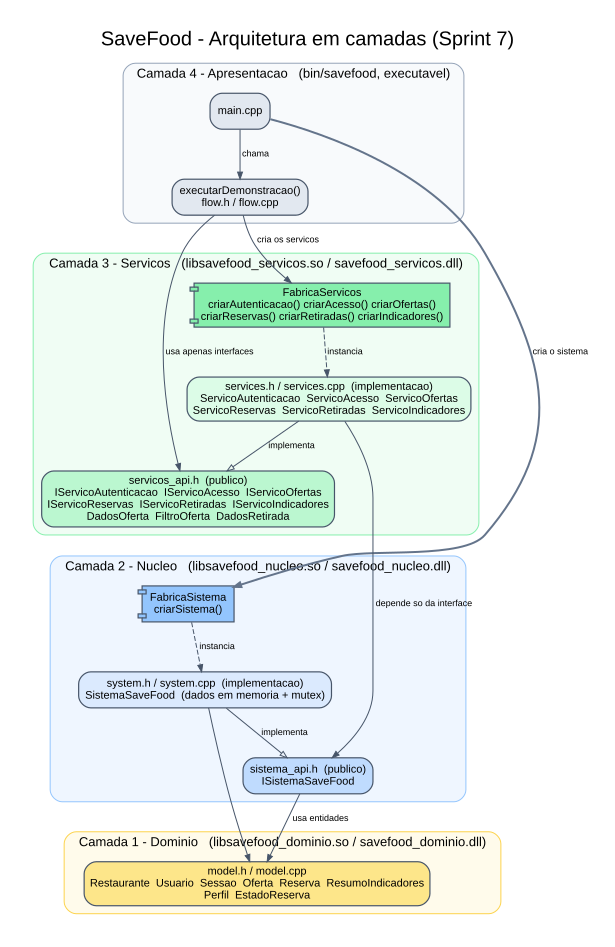

# SaveFood

Projeto em C++17 para a disciplina de Engenharia de Software da UFOP.
O codigo implementa o fluxo comercial minimo definido no backlog: acesso,
publicacao, consulta, reserva, cancelamento, confirmacao presencial e
indicadores basicos (SB01 a SB06 do Projeto da API).

**Sprint 7 - Arquitetura em camadas: componentizacao + fabricas.** Cada camada
do produto e um componente separado (biblioteca compartilhada: `.so` no Linux,
`.dll` no Windows). As camadas superiores conhecem as inferiores apenas por
interfaces abstratas e obtem os objetos por fabricas.

## Arquitetura em camadas



| Camada | Pasta | Componente | Interface publica | Fabrica |
| --- | --- | --- | --- | --- |
| 4 Apresentacao | `src/main.cpp`, `src/apresentacao/` | `bin/savefood` (executavel) | - | - |
| 3 Servicos | `src/servicos/` | `libsavefood_servicos.so` / `savefood_servicos.dll` | `servicos_api.h`: `IServicoAutenticacao`, `IServicoAcesso`, `IServicoOfertas`, `IServicoReservas`, `IServicoRetiradas`, `IServicoIndicadores` | `FabricaServicos` |
| 2 Nucleo | `src/nucleo/` | `libsavefood_nucleo.so` / `savefood_nucleo.dll` | `sistema_api.h`: `ISistemaSaveFood` | `FabricaSistema` |
| 1 Dominio | `src/dominio/` | `libsavefood_dominio.so` / `savefood_dominio.dll` | `model.h`: `Restaurante`, `Usuario`, `Sessao`, `Oferta`, `Reserva`, `ResumoIndicadores` | - |

Regras seguidas:

- **Dependencia so para baixo.** Cada camada inclui apenas cabecalhos da
  camada imediatamente inferior (ou do dominio). Nenhuma camada inclui algo
  de uma camada superior.
- **Dependencia por abstracao.** A apresentacao inclui somente
  `servicos_api.h` (que traz `sistema_api.h`); ela nunca ve `SistemaSaveFood`
  nem `ServicoOfertas`. Os servicos guardam um `ISistemaSaveFood*`, nao a
  classe concreta: por isso `libsavefood_servicos.so` nem precisa do nucleo
  para ser carregada (`readelf -d` lista apenas o dominio).
- **Fabricas como unico ponto de criacao.** `FabricaSistema::criarSistema()`
  e `FabricaServicos::criar...()` devolvem `std::unique_ptr` para a
  interface. Trocar o sistema em memoria por uma versao com banco de dados
  exigira alterar so a fabrica do nucleo; a apresentacao e os servicos nao
  mudam. As fabricas tem construtor removido (`= delete`), pois so possuem
  metodos estaticos.
- **Visibilidade controlada.** As bibliotecas sao compiladas com
  `-fvisibility=hidden` (Linux) e `__declspec(dllexport)` (Windows), via
  `src/exportacao.h`. So as classes marcadas com `SAVEFOOD_<CAMADA>_API` sao
  exportadas; funcoes internas, como `paraMinusculas` e o hash de senha,
  ficam invisiveis fora do componente (`make simbolos` lista o que cada um exporta).
- **Interfaces com destrutor virtual.** Os destrutores das interfaces sao
  definidos nas fabricas (`fabrica_*.cpp`), ancorando a tabela virtual e as
  informacoes de tipo dentro do proprio componente.
- As classes concretas continuam exportadas apenas para os **testes unitarios
  de caixa-branca**. Os **testes funcionais sao de caixa-preta**: usam somente
  fabricas e interfaces, como a apresentacao.

## Arvore de diretorios

O repositorio recebe o nome do produto. O codigo do produto fica em `src`,
os executaveis em `bin` e os testes em `test`. Ha tres arquivos `main.cpp`:
um para o produto, um para os testes funcionais e um para os testes unitarios.

```text
SaveFood/
|-- bin/                          # Componentes (.so/.dll) e executaveis gerados
|-- src/                          # Produto
|   |-- main.cpp                  # Camada 4 - ponto de entrada
|   |-- exportacao.h              # Macros de exportacao dos componentes
|   |-- apresentacao/             # Camada 4 - flow.h / flow.cpp (executarDemonstracao)
|   |-- servicos/                 # Camada 3 - componente savefood_servicos
|   |   |-- servicos_api.h        #   interfaces IServico*, tipos de entrada, FabricaServicos
|   |   |-- services.h / .cpp     #   implementacoes Servico*
|   |   `-- fabrica_servicos.cpp
|   |-- nucleo/                   # Camada 2 - componente savefood_nucleo
|   |   |-- sistema_api.h         #   interface ISistemaSaveFood, FabricaSistema
|   |   |-- system.h / .cpp       #   implementacao SistemaSaveFood
|   |   `-- fabrica_sistema.cpp
|   `-- dominio/                  # Camada 1 - componente savefood_dominio
|       `-- model.h / model.cpp   #   Restaurante, Usuario, Sessao, Oferta, Reserva, ResumoIndicadores
|-- test/
|   |-- unit/
|   |   |-- main.cpp
|   |   |-- unit_tests.h / unit_tests.cpp                 # funcoes globais
|   |   |-- unit_Restaurante.h / unit_Restaurante.cpp
|   |   |-- unit_Usuario.h / unit_Usuario.cpp
|   |   |-- unit_Sessao.h / unit_Sessao.cpp
|   |   |-- unit_Oferta.h / unit_Oferta.cpp
|   |   |-- unit_Reserva.h / unit_Reserva.cpp
|   |   |-- unit_ResumoIndicadores.h / unit_ResumoIndicadores.cpp
|   |   |-- unit_SistemaSaveFood.h / unit_SistemaSaveFood.cpp
|   |   |-- unit_ServicoAutenticacao.h / unit_ServicoAutenticacao.cpp
|   |   |-- unit_ServicoAcesso.h / unit_ServicoAcesso.cpp
|   |   |-- unit_ServicoOfertas.h / unit_ServicoOfertas.cpp
|   |   |-- unit_ServicoReservas.h / unit_ServicoReservas.cpp
|   |   |-- unit_ServicoRetiradas.h / unit_ServicoRetiradas.cpp
|   |   |-- unit_ServicoIndicadores.h / unit_ServicoIndicadores.cpp
|   |   |-- unit_FabricaSistema.h / unit_FabricaSistema.cpp
|   |   `-- unit_FabricaServicos.h / unit_FabricaServicos.cpp
|   `-- funcional/
|       |-- main.cpp
|       |-- funcional_tests.h
|       `-- funcional_tests.cpp
|-- doc/
|   |-- graficos/                 # Diagramas SVG e fontes DOT
|   `-- html/                     # Gerado pelo Doxygen (make docs)
|-- Doxyfile
|-- Makefile
|-- compilar_windows.bat
|-- gerar_documentacao.bat
`-- README.md
```

Os testes incluem o produto por caminho relativo, por exemplo
`#include "../../src/nucleo/system.h"`, por isso a compilacao nao precisa de `-I`.

## Testes unitarios

Convencoes adotadas:

- Para cada classe do produto ha um par `unit_<Classe>.h` / `unit_<Classe>.cpp`.
- Cada metodo publico tem uma funcao de teste independente
  `void unit_<Classe>_<metodo>(void)`. As operacoes canonicas usam os nomes
  `constructor`, `copyConstructor`, `assignmentOperator` e `destructor`.
- Cada `unit_<Classe>.cpp` possui `void run_unit_test_<Classe>(void)`,
  que invoca todos os testes da classe.
- Funcoes de escopo global sao testadas por `void unit_<funcao>(void)` em
  `unit_tests.h` / `unit_tests.cpp`, com `void run_unit_test_globals(void)`.
- `test/unit/main.cpp` inclui todos os cabecalhos e chama cada
  `run_unit_test_...()`.
- As verificacoes usam `assert`. Uma falha interrompe o programa e mostra
  o arquivo, a linha e a condicao. O Makefile compila os testes com
  `-UNDEBUG` para que os `assert` nunca sejam desligados.

| Arquivo | Testes | Destaques |
| --- | --- | --- |
| `unit_tests` | 1 | `executarDemonstracao` e acumulo dos indicadores em duas execucoes |
| `unit_Restaurante` | 6 | forma canonica e acessores |
| `unit_Usuario` | 9 | conferencia de senha |
| `unit_Sessao` | 6 | sessao encerrada e copia invalidada no sistema |
| `unit_Oferta` | 17 | validacao de campos, reserva e restauracao do saldo |
| `unit_Reserva` | 15 | estados Pendente, Cancelada e Retirada |
| `unit_ResumoIndicadores` | 4 | forma canonica |
| `unit_SistemaSaveFood` | 17 | SB01 a SB06 e reserva concorrente (secao 3.3) |
| `unit_ServicoAutenticacao` | 6 | entrar e sair |
| `unit_ServicoAcesso` | 5 | perfil e restaurante de vinculo |
| `unit_ServicoOfertas` | 7 | SB01 e SB02 |
| `unit_ServicoReservas` | 7 | SB03 e SB04 |
| `unit_ServicoRetiradas` | 6 | SB05 |
| `unit_ServicoIndicadores` | 5 | SB06 |
| `unit_FabricaSistema` | 2 | fabrica nao instanciavel; instancias novas e independentes |
| `unit_FabricaServicos` | 7 | cada fabrica entrega a implementacao certa ligada ao sistema e a sessao |

O teste `unit_SistemaSaveFood_reservar` reproduz a secao 3.3 do Projeto da
API: uma oferta com 4 unidades e dois consumidores pedindo 3 unidades ao
mesmo tempo, em duas threads, repetido 200 vezes. Exatamente uma reserva e
aceita, o saldo nunca fica negativo e o cancelamento do vencedor devolve as
3 unidades uma unica vez.

Os metodos privados de `SistemaSaveFood` (`prepararContasDemo` e
`usuarioDaSessaoSemLock`) e o construtor privado de `Sessao` sao testados
indiretamente, pelo construtor do sistema e por `entrar`.

## Testes funcionais

Sao testes de caixa-preta: criam o sistema com `FabricaSistema` e os
servicos com `FabricaServicos`, usando so as interfaces publicas.
Cada fluxo e implementado em uma funcao separada, declarada em
`test/funcional/funcional_tests.h` e definida em
`test/funcional/funcional_tests.cpp`:

| Funcao | Caso de uso | CT-01 | CT-02 |
| --- | --- | --- | --- |
| `testeReservarQuantidade` | SB03 | Reserva 2 de 5; saldo 3 e situacao Pendente. | Com saldo 1, reserva de 2 recusada sem novo registro. |
| `testeCancelarReserva` | SB04 | Reserva propria de 2 cancelada; saldo 3 volta a 5. | Novo cancelamento recusado; saldo continua 5. |
| `testeConfirmarRetirada` | SB05 | Gerente A confirma 2 unidades, 1 kg e R$ 24; situacao Retirada. | Gerente A nao confirma reserva do restaurante B; dados intactos. |

## Compilacao

No Linux, com `g++`, abra o terminal dentro da pasta `SaveFood`:

```bash
make            # gera as 3 bibliotecas .so e os 3 executaveis em bin/
make test       # executa os testes unitarios e funcionais
make simbolos   # quantidade de simbolos exportados por componente
./bin/savefood
```

Os executaveis procuram as bibliotecas na propria pasta `bin/` (rpath `$ORIGIN`).

No Windows, com MinGW-w64 (C++17 e threads POSIX), execute
`compilar_windows.bat`. O script gera as tres DLLs (com as bibliotecas de
importacao `.dll.a`) e os tres `.exe` em `bin/`, e executa os testes. As DLLs
precisam ficar na mesma pasta dos `.exe`. O projeto nao depende de bibliotecas externas, somente de C++17 e threads.

## Documentacao (Doxygen e Graphviz)

Com Doxygen e Graphviz instalados e no PATH:

- Linux: `make docs`
- Windows: `gerar_documentacao.bat` (gera e abre `doc/html/index.html`)

O `Doxyfile` le `src`, `test` e este README e grava em `doc/html`.
Os graficos `doc/graficos/camadas.svg` (arquitetura em camadas),
`doc/graficos/dependencias.svg` (includes entre os arquivos) e
`doc/graficos/classes.svg` (classes, interfaces e fabricas) foram gerados pelo
Graphviz a partir dos arquivos `.dot` da mesma pasta.

## Forma canonica

As classes concretas `Restaurante`, `Usuario`, `Sessao`, `Oferta`, `Reserva` e
`SistemaSaveFood` possuem construtor padrao, construtor de copia,
operador de atribuicao e destrutor. Em `SistemaSaveFood`, a copia dos
dados e protegida porque a classe possui um `std::mutex`.
As seis classes de servico tambem possuem as quatro operacoes canonicas.
As interfaces declaram construtores e atribuicao como `protected`, para que
so as implementacoes possam usa-los.
Copias de servicos compartilham o sistema de origem, sem possuir sua memoria;
o sistema deve permanecer vivo enquanto os servicos o utilizam.

## API alinhada ao Projeto da API (Sprint 2)

- `ServicoAutenticacao`: `entrar`, `sair`.
- `ServicoAcesso`: `permitir` (verificacao auxiliar; cada operacao tambem valida a sessao).
- `ServicoOfertas`: `publicar`, `consultar`, `detalhes`.
- `ServicoReservas`: `reservar`, `minhasReservas`, `cancelar`.
- `ServicoRetiradas`: `listar`, `confirmar`.
- `ServicoIndicadores`: `obterResumo`.

As operacoes preservam seus retornos: `false` para recusas, `0` para
publicacao recusada, sessao inativa para login recusado, `-1` para saldo
inacessivel e colecoes vazias ou resumo zerado para consultas sem acesso.

## Contas ficticias de demonstracao

| Papel | E-mail | Senha |
| --- | --- | --- |
| Gerente (restaurante 1) | `gerente@savefood.demo` | `gerente123` |
| Consumidor 1 | `consumidor@savefood.demo` | `consumidor123` |
| Consumidor 2 | `consumidor2@savefood.demo` | `consumidor123` |
| Gerente (restaurante 2) | `gerente2@savefood.demo` | `gerente123` |

## Limites desta versao

- Dados em memoria: o programa e uma demonstracao funcional, sem banco de dados.
- O hash simples de senha serve apenas para contas ficticias do exercicio;
  em producao deve ser substituido por Argon2id, scrypt ou PBKDF2.
- Pagamento e informado pelo gerente na retirada, sem integracao financeira.
- Retiradas parciais sao recusadas enquanto a regra nao for definida.
- Doacoes, expiracao e cadastro aberto estao fora do MVP implementado.
- Os dados de retirada ficam na propria `Reserva`; o modelo ER preve uma
  entidade `Retirada` separada, que ainda nao foi implementada.

Os testes usam exclusivamente dados de demonstracao.
